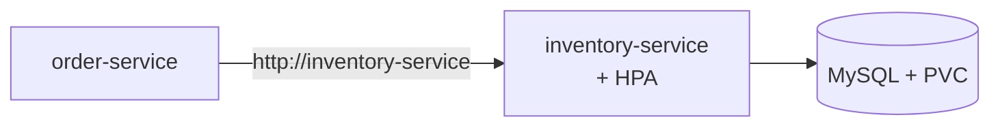

# argocd-inventory-order-app-simple

Argo CD deployment of the inventory-order-app from **plain YAML**: one
`Application` pointing at a directory of manifests. No Helm, no Kustomize.



```text
application.yaml     # the Argo CD Application (apply this once, by hand)
manifests/           # what Argo CD syncs: 2 Deployments, 3 Services, HPA,
                     # MySQL Deployment + PVC, 2 Secrets
```

Manifests were copied from `demo-test/inventory-order-app` in
[devops-learning-journey](https://github.com/ramanujds/devops-learning-journey)
at commit `d01cd7d`.

## Use

Prerequisite: Argo CD installed —
[installation notes](https://github.com/ramanujds/devops-learning-journey/blob/main/git-ops-argocd/04-argocd-installation.md).

```bash
kubectl apply -f application.yaml -n argocd

argocd app get inventory-order-app
kubectl get all -n inventory-order-app
kubectl port-forward svc/order-service -n inventory-order-app 8081:80   # http://localhost:8081
```

From here, `git push` is the deploy: edit anything under `manifests/`,
push, and Argo CD applies it (polls every ~3 min, or
`argocd app get inventory-order-app --refresh`). Manual `kubectl` edits
are reverted (`selfHeal`); files removed from `manifests/` are deleted
from the cluster (`prune`).

## Clean up

```bash
kubectl delete -f application.yaml      # the finalizer also deletes the workloads
```

## Caveats

- `manifests/mysql-secret.yaml` holds a plaintext password — demo only; use
  Sealed Secrets / External Secrets / SOPS for anything real
- no ordering between objects: `inventory-service` may restart a few times
  until MySQL is ready. The Helm sibling repo uses sync waves to avoid that
- NodePorts 30081 / 30082 — don't run alongside another stack using them

Same app via Helm: `argocd-inventory-order-app-helm`. Many apps from one
root: `argocd-app-of-apps`. Concepts and walkthrough:
[devops-learning-journey/git-ops-argocd](https://github.com/ramanujds/devops-learning-journey/tree/main/git-ops-argocd).
